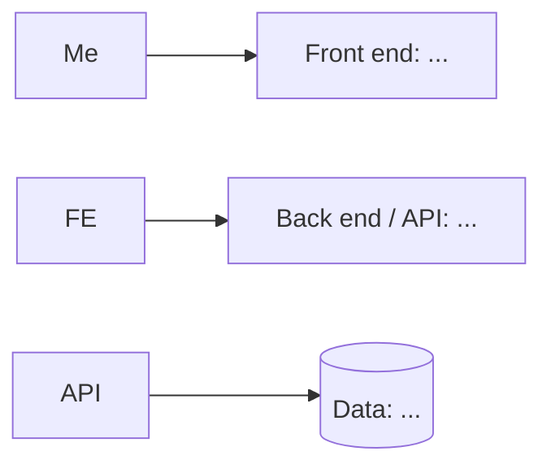

# [Asteria]

> Scheduling and shuffling time application.

**Author:** Romnis Ortiz · **Course:** CMP 464/343 Product 1 · **Last updated:** 10/23/26

---

## 1. About Me (the User)

*Who am I in the context of this problem? What roles am I playing (student, employee, parent, athlete, gamer…)?*

In the context of this problem I am just about anyone with a daily schedule/routine. So I am playing the role of a student, employee, parent, etc. Everyone

**The last 3 times this happened:**
*Real, recent moments. For each: when and where, what went wrong, what it cost, what you did.*

1.  Today in class 9/28, I was 6 minutes late. No real cost.
2.  Last week , I was late to work by 2 minutes, no penalty though.
3.  Sometimes I submit classwork on the same day its due just hours before its deadline.

**What it costs me:**
*Be specific. How often, how much?*

-  Time: couple minutes
-  Money: nothing really
-  Energy: a bit, since im usually running to get to work or to get to class or to submit things.
-  Joy: not much since a couple minutes isn’t too big of a penalty in my personal life. But sometimes I dread doing a piece of schoolwork.

---

## 2. Problem Statement

**Gut check:**

> I need **a better way to adjust and organize/reorganize my day/week** because **I struggle to manage my time when my plans are suddenly changed/interrupted**.

**Five Whys:**

1. Why? Because when my plans unexpectedly change I struggle to reorganize the rest of my day.
2. Why? Because I dont have a set specific schedule to guide me on how to rearrange my time.
3. Why? Because I currently plan my days around a general routine instead of a schedule.
4. Why? Because my day/week works and runs smoothly when my day/week goes as expected but doesn't give me much stability when something changes.
5. Why? Because I dont have a good way to plan and adjust how I can use my time when my day/week changes.

**Problem statement:**

> **When** my schedule/routine changes unexpectedly,  
> **I struggle to** reorganize my day and stick to new plans,  
> **which costs me** time and energy from rushing, being late, or from putting off schoolwork until the same day as or a few hours before the deadline.  
> **This happens because** I dont have a consistent way to plan and adjust how I use my time when my daily routine is interrupted.  
> **Right now I** plan my day/week mentally around my general routine, **but** this makes it difficult to adjust/readjust when something pops up unexpectedly or when something drops unexpectedly.

**I'll know this is solved when:** I can adjust my schedule when unexpected changes happen and I can still complete my routine/daily/weekly tasks without rushing or falling behind.

*Check: none of these words appear: app, website, platform, dashboard, tool, AI, track, automate, notify, feature.*

---

 3. Existing Solutions

|What I use or tried | What it does well | Why it falls short \*for me\*|
|-|-|-|
|Google Calendar | accessible on almost every device | too many steps and no easy copy paste or moving around, too many options|
|Apple Calendar | on my phone which I take everywhere | too many steps and no easy copy paste or moving around, too many options|

**The gap:** *In one sentence, what's still missing for me?*

Most planning methods/apps/programs have too many steps and setup so I prefer planning mentally, but that makes quickly adjusting plans rather difficult when things change unexpectedly.

---

## 4. Features & Benefits

*Every feature should move me toward my "solved when" line.*

|Feature (what it does)|Benefit (how my life gets better)|MVP or Later?|
|-|-|-|
|Create/resize time blocks which size is based on duration|It’ll allow me to visualize how much time each activity will take and how much time I have available|MVP|
|Click and drag blocks around the day|allows me to quickly reorganize my day when something unexpected changes|MVP|
|copy and paste block to other days|Makes it so that I dont have to manually recreate the same activities when planning other days/weeks/months|Later|
|View schedule by day, week, or month|Allows me to see how activities and dates line up in a bigger picture|Later|

| |

**MVP (2–3 features):** *The skateboard: the smallest version I'd actually use.*

* create time blocks, moving the time blocks around.

**Later:**

*  making it look clean and presentable

**Not doing:** *Things I'm deliberately leaving out.*

* The entire year as a schedule, thats a bit too much

---

## 5. Tech Stack

### Front end

* **Surface:** [ Web]
* **Tools:** [ Next.js + react]
* **Why:** *I want to be able to view it on my phone AND on my pc*

## Back end

|Piece|Choice|Why|
|-|-|-|
|Server / API|Next.js + React|Builds the website|
|Data Storage|SQLite|Stores the schedule|
|Hosting|Vercel|Hosts website|
|additional|Turso|Lets SQLite work as an online database with vercel.|

| |  
| Data storage | | |  
| Outside services (optional) | | |  
| Hosting / deploy | | |

\### Architecture sketch

\---

## 6. Open Questions

*What am I still unsure about? What do I need to figure out or test first?*

I have almost no experience with Next.js, React, Vercel or SQLite, so this is kind of a “throw stuff at the wall and see what sticks project”

<
